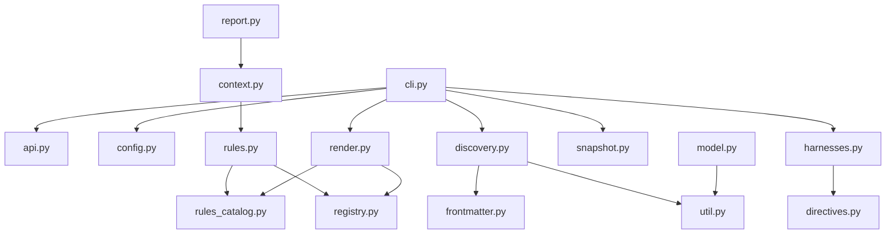

# Architecture

## Design vocabulary

Following the vendored `improve-codebase-architecture` methodology, a **deep
module** has a small interface hiding a large implementation. The **interface
is the test surface**; a **seam** is a boundary where behavior can be observed
without reaching inside. The **deletion test** asks whether removing a module
concentrates complexity or merely moves it.

## Module map

| Module | Responsibility | Interface |
|---|---|---|
| `util.py` | Bounded IO, containment, sanitization, redaction, hashing | `safe_read`, `safe_write`, `sanitize`, `redact_obj` |
| `frontmatter.py` | Small explicit YAML-subset parser | `parse_frontmatter` |
| `model.py` | Plain dataclasses and JSON serialization | `to_dict()` |
| `config.py` | Strictly validated `prism.json` | `load_config` |
| `discovery.py` | Bounded walk, classification, `@import` BFS | `discover`, `collect_targets` |
| `harnesses.py` | Four versioned resolver models + divergence | `resolve`, `resolve_all`, `all_divergences` |
| `directives.py` | High-precision extraction, contradiction, duplication | `extract`, `contradictions`, `duplicates` |
| `context.py` | One dependency carrier for a scan | `ScanContext` |
| `rules_catalog.py` | Declarative rule metadata | `RULES_CATALOG` |
| `registry.py` | Rule and renderer plug-in registries | `RuleRegistry`, `RendererRegistry` |
| `rules.py` | Registered executable checks | `RULES`, `run_rules` |
| `report.py` | Deterministic report assembly | `build` |
| `render.py` | TTY / JSON / Markdown / SARIF | `render` |
| `snapshot.py` | Per-file context fingerprints | `build_snapshot`, `compare` |
| `api.py` | Import-safe library API | `audit`, `resolve`, `build_snapshot` |
| `cli.py` | Argument parsing and exit codes | `main` |

## Data flow

1. `load_config` validates user intent.
2. `discover` reads bounded instruction files and expands `@import` safely.
3. `resolve_all` computes one `Resolution` per harness for a target.
4. `directives.extract` tokenizes included sources (memoized).
5. `ScanContext` carries discovery, resolutions, config, and divergences.
6. `RuleRegistry` runs three registered checks and sorts findings once.
7. `Report.to_dict()` applies recursive redaction at the serialization boundary.
8. `RendererRegistry` selects TTY, JSON, Markdown, or SARIF.
9. `snapshot` fingerprints the same composition for every target and harness.

## Extension points

- **New rule:** add metadata to `rules_catalog.py`, write a function taking
  `ScanContext`, register it in `rules.py`. No orchestrator edit.
- **New renderer:** add a `Renderer` in `render.py`. No `if` branch.
- **New harness:** add a resolver and a documented `Harness` entry.
- **New config key:** add type/bounds validation in `config.py`; unknown keys
  remain hard errors.

## Boundaries that survived the deletion test

- `util.py` could not be merged into callers without duplicating the security
  invariants.
- `frontmatter.py` stays separate because a silent misparse is worse than a
  visible warning.
- `rules_catalog.py` stays separate so `explain` and SARIF do not import
  detection logic.
- `context.py` is small on purpose: it removes a four-argument fan-out, not
  adds a framework.

## Behavior freeze

`tests/golden/BASELINE.json` was captured before the architecture refactor. See
[ARCHITECTURE_REFACTOR.md](ARCHITECTURE_REFACTOR.md).
