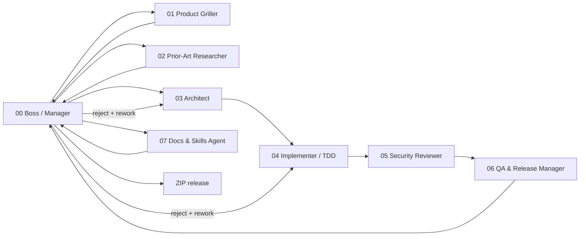

# Agent workflow

The session was run as a small, specialized team with one strict manager. Each
agent owns one artifact type and cannot mark work done without a concrete
handoff.

## Roster

| Agent | Specialization | Must deliver | Reject if |
|---|---|---|---|
| `00-boss` | Scope, gates, rejection | Signed plan, review log, release verdict | Any claim outruns evidence |
| `01-product-griller` | Deep thinking, self-grilling | Candidate table, 8+ objections, decision | No disconfirming evidence |
| `02-prior-art-researcher` | Evidence and star dynamics | Prior-art matrix with URLs and gaps | "Does not exist" without bounded-search wording |
| `03-architect` | Deep modules, seams, refactor | Module map, golden gate, extension points | Orchestrator edits required to add a rule |
| `04-implementer` | TDD, CLI, tests | Code + tests for every behavior | Untested rule or unbounded IO |
| `05-security-reviewer` | Hostile input, redaction | Threat model, hostile regressions | Secret appears in any format |
| `06-qa-release-manager` | Determinism, CI, packaging | Full suite, formats, CI, zip | Golden hash differs |
| `07-docs-skills` | Docs, agent contracts, skill bundle | README, docs, agents, skills, notices | Reconstructed skill presented as verbatim |

## Handoff contracts

1. **Idea → Spec:** candidate IDs, assumptions, predictions, evidence status,
   named decision, revisit triggers.
2. **Spec → Architecture:** constraints, module boundaries, behavior-freeze
   hashes, public API.
3. **Architecture → Implementation:** file list, dataclasses, rule IDs, exit
   codes, output formats.
4. **Implementation → Security:** tests, demo corpus, known weak spots.
5. **Security → QA:** threat model, redaction tests, containment tests.
6. **QA → Boss:** test count, golden result, command transcript, artifact list.
7. **Boss → Docs:** approved claims, rejected claims, limitations.
8. **Docs → Boss:** every referenced file exists; no dangling links in the
   project's own documentation.

## Strict manager protocol

- Every round ends with a verdict: **accepted**, **rework**, or **rejected**.
- A round with no concrete defect, fix, and regression test is reworked.
- A "faked" result means a claim that cannot be reproduced by running a
  command in this repository; it is rejected.
- The manager does not average scores. A single safety or behavior-preservation
  failure vetoes the round.
- The final round reruns every gate, not just the last changed file.
